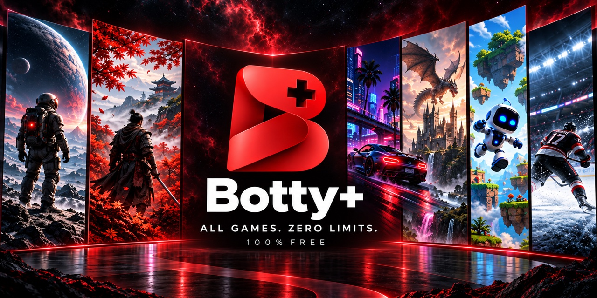
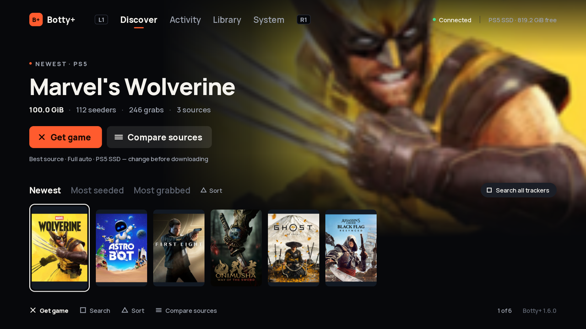
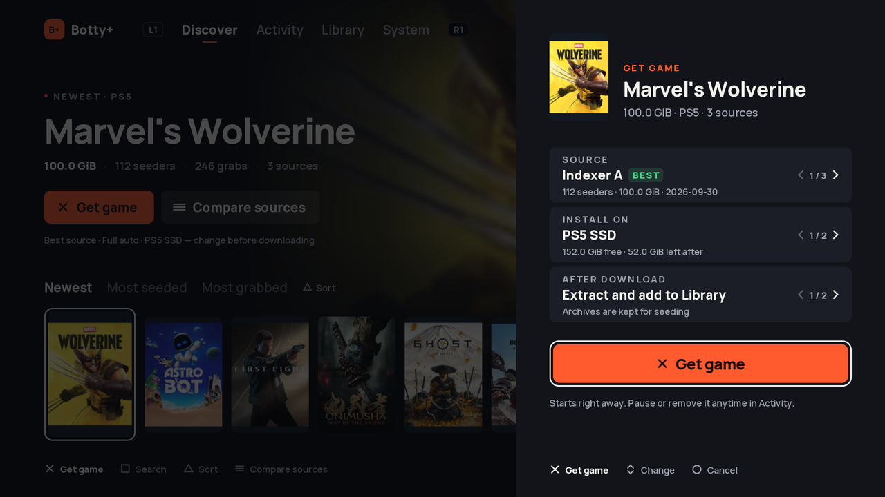
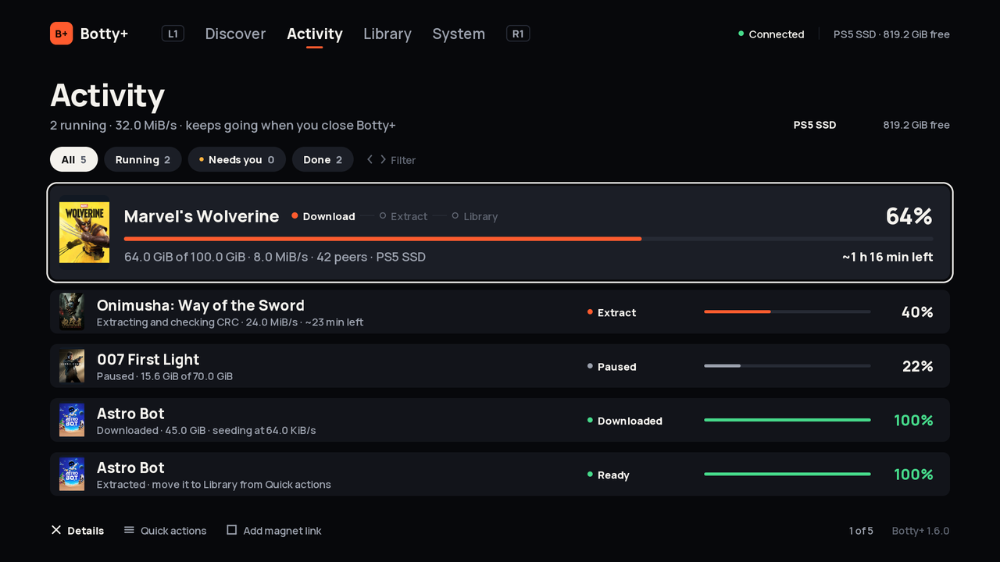
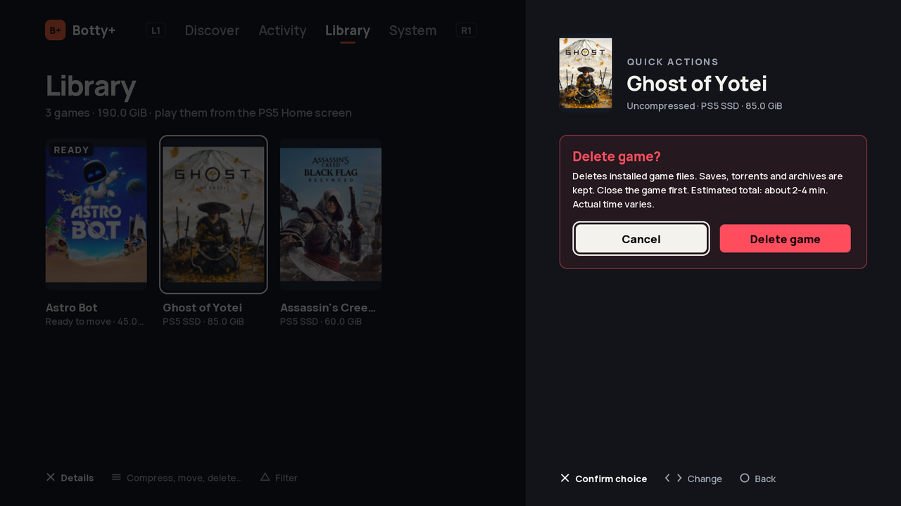

  

<h1 align="center">Botty+</h1>

Your downloads. Your library. On PS5.

<strong>PS5 firmware 7.00–13.60</strong> · Requires a compatible jailbreak session · <a href="homebrew/botty-native/VALIDATION.md">Compatibility details</a>

  <a href="#get-started">Get started</a> ·
  <a href="#using-botty">How to use it</a> ·
  <a href="#troubleshooting">Troubleshooting</a> ·
  <a href="#credits">Credits</a> ·
  <a href="https://github.com/Portablelle/Botty-Plus/releases/latest">What's new</a>

Botty+ is a PS5 app for finding, downloading and organizing your games
from the couch, with your controller. Pick a game, choose where it goes, and
Botty+ downloads it, extracts it and adds it to Library for PS5 games or
Emulation for Switch games. Downloads and file
operations keep running in the background after you close the app.

## Highlights

- **New in 2.0.0 — Switch emulation:** play from the Emulation tab with an
  embedded engine, automatic game/update/DLC imports and per-game settings.
  No separate ProsperoEden installation is required. See the
  [setup and compatibility guide](docs/EMULATION.md).
- **Discover:** browse popular releases or search every connected tracker, then
  get a game in one step.
- **Activity:** follow every download, extraction, move and deletion in one
  list, with progress and time remaining.
- **Library:** see your games with their covers and where each copy is stored,
  compress supported games to save space, move them or delete them.
- **External storage:** use the PS5 SSD or an external exFAT disk, and move
  games between them.
- **Phone or computer access:** add downloads and follow them from a browser on
  the same network.

## Credits

Botty+ builds on the work of these authors and contributors. Thank you for the
native foundations, emulator, download engine and libraries that make it possible.

| Component | Authors and contributors |
| --- | --- |
| [PS5 native app boilerplate](https://github.com/blackbearreloaded/ps5-native-app-boilerplate) | **BlackBearReloaded** and contributors — native runtime, VideoOut renderer and build tooling. |
| [ProsperoEden](https://github.com/blackbearreloaded/ProsperoEden) | **BlackBearReloaded** and contributors — the embedded Switch engine's PS5 port and frontend. |
| [Eden emulator](https://github.com/eden-emulator/mirror) | The **Eden project** and its upstream contributors — the Switch emulator core. |
| [PS5 Mesa](https://github.com/mihawk-99/PS5_Mesa) and [PS5 Vulkan](https://github.com/mihawk-99/PS5_Vulkan) | **Mihawk** and upstream contributors — graphics drivers used by the embedded engine. |
| [PS5-Lapy-JB-Daemon](https://github.com/ArkSama/PS5-Lapy-JB-Daemon) | **ArkSama / Team PHU**; cooperative helper work by **mpereiraesaa** and **BlackBearReloaded**. |
| [rTorrent](https://github.com/rakshasa/rtorrent) and [libtorrent](https://github.com/rakshasa/libtorrent) | **rakshasa** and contributors — torrent downloads. |
| [PS5-Game-Compressor](https://github.com/gcoding97/PS5-Game-Compressor) | **gcoding97** and upstream contributors — Library compression. |
| [UnRAR](https://www.rarlab.com/rar_add.htm) / [unrar-ps5](https://github.com/bizkut/unrar-ps5) | **Alexander Roshal** — UnRAR; **bizkut** — the PS5 port. |
| [PS5 Payload SDK](https://github.com/ps5-payload-dev/sdk), [PacBrew](https://github.com/ps5-payload-dev/pacbrew-repo) and [PS5 SDL headers](https://github.com/ps5-payload-dev/SDL) | **John Törnblom**, the **ps5-payload-dev** contributors and **SDL** contributors. |
| [cpp-httplib](https://github.com/yhirose/cpp-httplib) | **yhirose** and contributors — HTTP server and client. |
| [JSON for Modern C++](https://github.com/nlohmann/json) | **Niels Lohmann** and contributors — JSON support. |
| [stb_image](https://github.com/nothings/stb) | **Sean Barrett** and contributors — local image decoding. |
| [Manrope](https://github.com/googlefonts/manrope) and [Montserrat](https://github.com/JulietaUla/Montserrat) | The **Manrope Project Authors** and **Montserrat Project Authors** — interface fonts. |
| [UltraCam / NX Optimizer](https://github.com/MaxLastBreath/nx-optimizer) (optional mod) | **MaxLastBreath**. |
| [Prowlarr](https://github.com/Prowlarr/Prowlarr) (optional search service) | The **Prowlarr team** and contributors. |

The PS5 session supplied by [Portal+](https://github.com/Portablelle/Portal-Plus)
also relies on **Drakmor**'s [ShadowMountPlus](https://github.com/drakmor/ShadowMountPlus),
**EchoStretch**'s [Kstuff Lite](https://github.com/EchoStretch/kstuff-lite), based
on **sleirsgoevy**'s work, and the **Relapse exploit authors**. See
[Portal+ Credits](https://github.com/Portablelle/Portal-Plus#credits) for those
components and the other optional apps.

See [third-party credits and licenses](THIRD_PARTY.md), the
[native dependency notices](homebrew/botty-native/vendor/NOTICE.md), and the
[embedded engine and mod notices](packages/botty-native/NOTICE.md) for detailed
provenance and redistribution terms. Components retain their own licenses.

## Get started

### What you need

- A PS5 on firmware 7.00–13.60 that can run a jailbreak session
  ([compatibility details](homebrew/botty-native/VALIDATION.md)).
- Access to a **Portal+** site: the web page that starts the jailbreak and
  installs Botty+. Ask whoever provides your portal for its address, or
  [host your own](https://github.com/Portablelle/Portal-Plus).
- Enough free space for your downloads and the extracted games. An external
  disk must be formatted as exFAT.

### Install Botty+

1. **Open Portal+ on your PS5.** Use the address you were given. If your portal
   uses the User's Guide shortcut, follow the
   [DNS and User's Guide walkthrough](https://github.com/Portablelle/Portal-Plus/blob/main/docs/CONSOLE-SETUP.md).
2. **Check Botty+ in "Your loadout".** It includes the download engine; there
   is nothing else to select.
3. **Select LAUNCH** and keep the page open until it shows **READY**.
4. **Open Botty+ from the home screen.** Press the PS button and select the
   Botty+ icon. On the first installation, the icon can take a moment to appear.

After each console restart, open Portal+ and select **LAUNCH** again before
opening Botty+.

### Your first PS5 download

- **From Discover:** select a game, check the **Get game** sheet and press Cross.
  Discover works once your portal provider has
  [set up game search](deployment/README.md#optional-search-and-explore).
- **From a magnet link:** in **Activity**, press Square and paste or type the link.

In the **Get game** sheet, choose:

- **Download on:** the PS5, or a dedicated server if your portal provider has
  configured one.
- **Install on:** the PS5 SSD or your external disk.
- **After download:** **Extract and add to Library** to have everything done
  for you, or **Keep the download only** to handle the next steps yourself.

Botty+ remembers both choices until you close it. Follow progress in **Activity**;
the game appears in **Library** once it is ready.

### Switch games

Open **Emulation** and press Square to search. Choose the download destination
and automatic preparation to extract, verify and import supported games,
updates and DLC. Follow progress in **Activity**, then return to **Emulation**
to play. Triangle switches between **Games**, **Updates / DLC** and
**Available files**. Options on a game opens its per-game settings;
the **Config** tab opens global settings.

Switch emulation requires your existing firmware and keys, provisioned
separately through your private Portal endpoint. They are not included in
the public release. See [setup and supported formats](docs/EMULATION.md).

## Using Botty+

Press L1 or R1 to switch between tabs.

| Tab | What you do there |
| --- | --- |
| **Discover** | Browse releases by newest, most seeded or most downloaded, or search every tracker. |
| **Activity** | Follow downloads and file operations, pause or resume them, extract an archive or add a magnet link. |
| **Library** | See your games, filter by disk or compression, compress, move or delete a game. |
| **Emulation** | Search, import and launch Switch games, manage updates and DLC, and press Options on a game for its per-game Config. |
| **Config** | Open the embedded Switch engine's global settings. |
| **System** | Find the web address and login for your phone or computer, update Botty+, reconnect or close the app. |

| Button | Action |
| --- | --- |
| L1 / R1 | Switch tabs |
| D-pad / left stick | Move around; left and right change an option in a sheet |
| Cross | Select or confirm |
| Circle | Go back, or dismiss an error message |
| Options | Show item actions, compare sources in Discover, or open per-game Config in Emulation → Games |
| Square | Search in Discover or Emulation, add a magnet link in Activity |
| Triangle | Change the Discover ranking, filter Library, refresh Activity, or cycle Emulation's Games / Updates & DLC / Available files views |

To close the app, open **System** and select **Close Botty+**. Circle never
closes it by accident.

Pause, resume and verify happen right away. Deleting, cancelling or restoring
asks you once more, with **Cancel** selected so a quick press is safe. Moving a
game to another disk opens a sheet instead: check the destination before you
confirm, because the copy on the old disk is removed once the move succeeds.
A short message confirms each request; errors stay on screen until you press
Circle.

From a phone or computer on the same network, open the web address shown in
**System** and sign in with the login details shown there. From there you can
also upload a `.torrent` file.

### Keep Botty+ up to date

When an update is available, **System** shows it. Select **Update and close**,
then **Install and close**. Close any other app you opened first. Botty+ waits for
running extractions, compressions and moves to finish, installs the update and
lets you know when you can reopen it. Downloads pause only if needed and resume
afterward.

In-app updates are new and still being tested on consoles.

You can also update through Portal+: let running extractions, compressions
and moves finish, close Botty+, restart the console, then select **LAUNCH**.
Do not run **LAUNCH** while an in-app update is waiting or installing. See
[updates and rollback](deployment/README.md#updates-and-rollback) for details.

## Good to know

- **Your files are kept.** Botty+ keeps the original download after extracting it,
  and keeps the original game after compressing it until you choose to delete it.
- **PS5 preparation:** RAR extraction includes password-protected and multi-part
  archives. Local ZIP/7z extraction, direct PKG installation on the PS5 and
  launching PS5 games from Botty+ are not supported. A configured dedicated
  server can convert supported FPKG releases; see [game preparation](docs/game-preparation.md).
- **Switch preparation:** supported RAR/ZIP archives are extracted automatically,
  and NSP/XCI games, updates and DLC are verified and imported into Emulation.
  Switch games launch directly from that tab. NSZ/XCZ are not supported.
- **Interrupted work:** an interrupted extraction can resume on the same disk;
  an interrupted compression starts again from the beginning.
- **Rest mode is experimental.** Botty+ asks the console to keep its services
  running in rest mode, but long sessions can still be interrupted. Check the
  rest-mode status in the web interface.
- **Testing status:** Botty+ has been used on PS5 firmware 13.00. Other firmware
  versions and some workflows still need hardware testing; see
  [compatibility and known limitations](homebrew/botty-native/VALIDATION.md).

## Troubleshooting

| Problem | What to try |
| --- | --- |
| The Botty+ icon does not appear | Wait a moment after **READY**, then check the home screen again. If it is still missing, select **LAUNCH** again. |
| Botty+ cannot reach its service after a restart | Close Botty+ with **System → Close Botty+**, open Portal+, select **LAUNCH** and wait for **READY**, then reopen Botty+. |
| Discover is empty | Game search is optional and must be set up by your portal provider. Magnet links and `.torrent` uploads work without it. |
| An extraction needs your attention | Open the item in **Activity**: it may need a password, a missing part of the archive or more free space. |
| **Update queued** appears in System | Select **Close for update**. Botty+ finishes running extractions, compressions and moves, then installs the update. Do not run **LAUNCH** meanwhile. |

## Screenshots

Discover leads with the focused game and its cover art. The **Get game** sheet
picks the source, the disk and what happens after the download.

Activity follows downloads, extractions and moves in one list. Deleting asks
once more, with Cancel selected.

*Rendered from the app's own drawing code with sample PS5 titles; not captured
on a console.*

## More information

For users:

- [Release notes](https://github.com/Portablelle/Botty-Plus/releases)
- [Screens and controls in detail](homebrew/botty-native/README.md#screens-and-controls)
- [PS5 DNS and User's Guide setup](https://github.com/Portablelle/Portal-Plus/blob/main/docs/CONSOLE-SETUP.md)
- [Compatibility and known limitations](homebrew/botty-native/VALIDATION.md)

For portal hosts and developers:

- [Portal+ hosting](https://github.com/Portablelle/Portal-Plus)
- [Game search, cover art, updates and rollback](deployment/README.md)
- [Compression and recovery](homebrew/game-compressor/README.md)
- [External storage](homebrew/botty/README.md#external-storage-13)
- [Building and contributing](docs/DEVELOPMENT.md)
- [Versioning policy](docs/VERSIONING.md)

Botty+ is an independent homebrew project, not affiliated with Sony Interactive
Entertainment.
