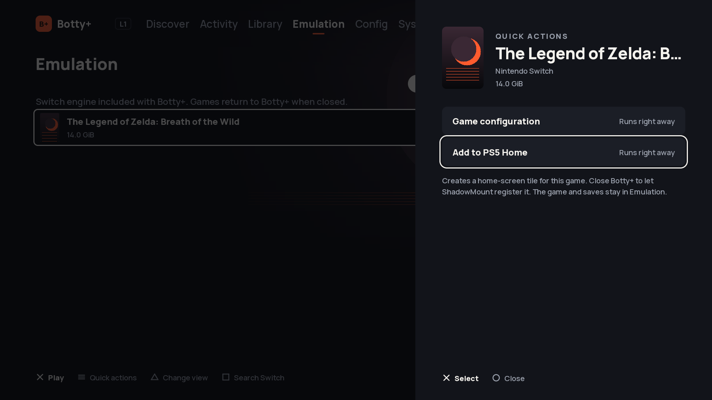

# Embedded Switch engine

The Emulation tab supports Games, Updates / DLC and completed NSP/XCI downloads.
The standalone build packages a pinned ProsperoEden engine inside the Botty title
`PPSA99071`, at `emulation/eboot.bin`. It does not launch or require `PPSA99008`.
The engine's exact-title helper is rebuilt for Botty. Its self-updater is disabled;
Botty's installation transaction owns both executables. A normal game exit or
engine restart loads Botty's main `eboot.bin`.

Builds require complete corresponding sources, package validation and PS5 launch/return acceptance. Compilation alone does not authorize deployment.

## Controls and data

Triangle cycles Games, Updates / DLC and Available files. Cross plays a library
game or copies a completed download into the game library. Completed files use one Analyze and import action; their verified metadata determines whether they are a game, update or DLC. Originals are preserved and name collisions are refused.
Eden determines title compatibility and applies compatible updates/DLC on launch.
Games show the title and base display version from their Control/NACP data,
embedded artwork, associated updates and DLC, and named mods with their saved
on/off switches. The selected game's panel includes its title ID and filename.
Legacy NSP/XCI files copied manually are inspected too; display metadata is
cached by file identity and private-key revision, without changing game files.
The display scan reads CNMT and Control data with bounded reads and does not
rehash entire games or confer import verification. Numeric CNMT revisions are
labelled as revisions when a readable NACP version is unavailable. Update/DLC
presence is distinct from the engine's compatibility/activation decision at launch;
mod switches do not establish build compatibility. Unreadable metadata keeps the
file visible with an explicit unavailable state.
Square opens a Switch search using the existing PS5/server download choices.
Automatic Switch downloads extract, verify and classify content before importing it into Emulation, on the PS5 or dedicated server. Download-only mode remains available.

Standalone data lives in `/data/botty/emulation/switch`. An explicit `game_files`
in that root's `config/prosperoeden.json` selects another assets root. Existing games and updates in the old ProsperoEden data folder are offered in
Available files for copying into the standalone library. The old folders,
configuration, games and saves are not moved or deleted. Saves are not migrated
automatically.
Inventory is bounded to 256 files, 4096 entries and eight nested levels; symlinks
are rejected. NSP/XCI structure, archive CRC, encrypted CNMT metadata and required content hashes are checked. NSZ/XCZ remain unsupported. This is not Nintendo signature verification.

## PS5 home-screen shortcuts

In Emulation → Games, Options opens **Quick actions** with **Game configuration**
and **Add to PS5 Home**. Adding a game stages a complete, separate homebrew title
with its game name and cover (Botty's icon if no cover is readable). Close Botty+
so ShadowMountPlus can register the tile. Repeating a request keeps the same tile.
Existing application folders and registered identities are never reused. Games,
updates, private keys and saves stay in the existing embedded engine's folders.

Tiles use the shared [PS5 Forwarder Format](https://github.com/heydemoura/ps5-forwarder-format),
pinned at `22e8762ad7dbd01e18bd8c0e95f86461fdf8aaf4`. The manager embeds the unchanged
upstream template; its GPL source, license and rebuild instructions are bundled
under `homebrew/botty/vendor/ps5-forwarder-format`. No forwarder files extend the
native installation manifest. Each tile targets `PPSA99071` with
`--botty-home-game <library entry ID>`. Botty resolves the ID through the existing
launch API before loading `/app0/emulation/eboot.bin`; missing games or provisioning
open Botty with an error instead. Arguments are consumed once and are not replayed
when the game returns to Botty. The engine and normal save-sync lifecycle are shared.

The jailbreak, ShadowMountPlus and the local ELF loader must be available. On first
use, the upstream tile starts its bundled loopback-only launcher if none is running.
Close an already running Botty+ session before launching a tile: arguments apply to
a newly started process. Host tests and rendered previews are separate from PS5
registration and launch acceptance, which must be recorded before publishing.

## Private provisioning

The owner's existing `keys/` and `firmware/` are provisioned separately from the
public app. Portal's `botty-switch.js` downloads a private manifest and its files
from `/private/switch/`, verifies SHA-256 and sizes, preserves differing existing
files, resumes matching files and writes `private-runtime.json` only at completion.
The manager requires that completion marker before accepting a launch.
The engine tests access inside the private runtime directory before startup.
A mounted, writable `/data` alone is insufficient: ShadowMount can expose it to
the sandbox while Botty’s private directories still require process elevation.

The Portal repository includes an HTTPS nginx location with HTTP authentication.
It must point outside every public release directory; credentials and private
files must never enter Git, public package manifests or corresponding-source
archives. A missing authenticated endpoint prevents private provisioning.
Configuring this endpoint is a deployment step, not part of the compiler setup.

## Build on the dedicated server only

1. Build `emulation/Dockerfile` on `dedie` in an isolated directory.
2. Run `emulation/prepare.py CHECKOUT` against a fresh checkout; it verifies
   upstream commit `8f392248f7d49fc2be47f60ad7764ac5a392b1fe` and applies the Botty
   title, storage, helper and lifecycle changes. Modified checkouts are refused.
3. Inside that builder, run `make package JOBS=3` in the prepared checkout. Keep
   its parent directory isolated: upstream dependencies use sibling directories.
4. Build the Botty UI with its normal dedicated builder. Run
   `emulation/sources.py CHECKOUT build/emulation-source.tar.gz` from the native
   source directory on the dedicated host to archive the engine/dependency sources.
   Then run
   `emulation/assemble.py CHECKOUT/build/release/PPSA99071` on the dedicated server
   to attach the engine, its assets and its pinned libc to the Botty package.
5. Package corresponding engine/dependency sources and licenses, validate the
   combined manifest, then run console acceptance before publishing.

The title declares the engine's memory reservation and video attributes. File
limits are raised to 128 MiB for the engine; package manifests remain bounded to
2048 files and 512 MiB. Existing 13-file Botty packages remain accepted. Engine
paths are confined to `emulation/`; firmware, keys and NCA files are forbidden
there. Portal and manager updates must ship this extended contract together.

## API

Authenticated `GET /api/state` includes `emulation`. Entry IDs derive from kind
and canonical path and are resolved again on action.

- `POST /api/emulation/launch` with an entry ID validates a local game, packaged
  engine and private provisioning, then returns `launchPath` and
  `engine: "embedded-eden"`. The UI validates the response, stops its workers,
  releases video/pad resources and invokes the packaged executable with `--rom`
  and `--exit-after-game`. No client-supplied executable path is accepted.
- `POST /api/emulation/home` accepts only a library entry `id`, validates the
  game and private provisioning, and publishes an idempotent shortcut. State
  advertises `homeScreenSupported` and each game's `homeTitleId`. The response
  includes `ok`, `titleId` and `existing`; creation does not claim registration.
- `POST /api/emulation/import` accepts a completed download entry ID and optional kind `auto`. Legacy forced types are refused with a refresh hint. Background copying excludes installation updates and other
  file operations. Activity reports progress.

The dedicated bridge recognizes completed NSP/XCI members and preserves the
server-download/import flow. Its code changes require separate deployment.

Upstream: https://github.com/blackbearreloaded/ProsperoEden (GPL-3.0-or-later).

### UltraCam per-game configuration

Config → select a game → UltraCam provides an optional bundled UltraCam 1.0.1 mod by MaxLastBreath for Breath of the Wild 1.6.0. It starts disabled. The page includes a target frame rate, game resolution, quality, render distance, FOV and camera settings. These settings belong to the game and do not change the global render scale or TV refresh rate. A target of 60 FPS does not guarantee 60 FPS on PS5.

Enabling checks the effective Control/NACP display version, confirms that the selected Program patch can apply to the base ROM, and verifies the bundled payload hashes. External updates take precedence over packed updates as in the loader. Advanced disabled-update overrides block activation instead of approving a version that might not run. Botty writes a managed mod under `mods/01007EF00011E000/Botty UltraCam/`, leaves other mods alone and refuses to overwrite an unmanaged or modified folder. Changing the game's update to an unsupported version disables this mod for that launch; it can always be turned off in Config. The game-wide Mods switch must also be on; enabling UltraCam never changes other mods’ activation. The mod is separately licensed CC-BY-NC-2.0; attribution, license, pinned upstream revision and file hashes ship in `emulation/ultracam/`.

Validation: `emulation/tests/ultracam_check.cpp` exercises version gates, integrity, per-game INI settings and preservation; `emulation/tests/ultracam_ui.py` uses the real settings renderer.

### Switch archive preparation

`platform: "switch"` is persisted from search/download/import through the
automatic task and dedicated-server registry. The native search no longer adds
a literal `Switch ` prefix to the query. Automatic mode extracts RAR (including
tracked volumes), ZIP/ZIP64, and bounded nested archives into private staging.
NSP/PFS0 and XCI/HFS0 tables, encrypted NCA metadata, CNMT identities, sizes
and SHA-256 hashes are checked before a batch becomes visible in Emulation.
Missing optional update delta fragments are recorded; missing program/data
content is refused. NSZ/XCZ and rights-managed metadata remain explicit errors.
This verifies structure and consistency, not Nintendo signatures.

Game, update and DLC types come from CNMT; an unlocker label comes from a
matching NFO declaration, retained separately from its actual DLC metadata.
NFO title IDs may contain wildcards and must agree with the inspected IDs.
NFO text is never executed. Required base games and updates appear in the
library status; updates/DLC stay in the emulator's recursive addon folder.
Both server and console preserve downloads. Interrupted batch publication is
hidden until its receipt is complete and recovery checks file identities.

Validation: `tests/switch_pipeline.py`, `tests/emulation_integration.py`,
`deployment/botty-remote/test_switch_prepare.py`, native model/renderer tests.

Download completion is followed by a two-second unchanged source inventory
window, covering the torrent client's final timestamp writes. A change resets
that window; source identities and content hashes remain checked during actual
preparation. The dedicated adapter applies the same admission delay.
Switch search results open the settings sheet on Download on; opening a sheet
discards buffered controller actions and waits for release before accepting a
new confirmation. Run `make test-switch` on the dedicated build host for the
archive/metadata, source-settlement and server-adapter checks.

## Configuration and video counters

Config opens the embedded engine's complete settings UI. Options on a library
game opens its per-game overrides. Circle at either settings root returns to
Botty+. The engine's existing profile-aware settings store owns persistence.

Output resolution, internal rendering scale and display refresh are independent.
For a 1080p game, 2x requests 3840x2160 rendering; 2160p selects the output size.
120 Hz selects the display refresh and does not unlock a game's frame rate. The
HUD's resolution currently reports the guest framebuffer before render scaling.

## Complete corresponding sources

GitHub limits individual repository files. Large source archives are published
losslessly in `packages/botty-native/source/`, with sizes and SHA-256 hashes in
`source/manifest.json`. `botty-native-source.tar.gz` is the small entry archive
containing the index and `restore.py`. Extract it and run the tool against the
complete package directory to reconstruct the full archive. Parts are source
artifacts only and are never installed on the PS5.

Direct Botty launches use the built-in launcher’s normal save-sync and play-registration lifecycle. Save conflicts are resolved before launch; pending post-game saves are synchronized before returning to Botty, with failed synchronization retained for retry. Per-game configuration accepts safe nested library paths as well as owned import batches.
